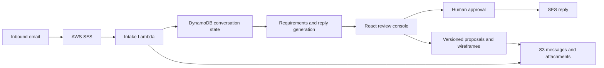

# SoloPilot

An AI-assisted client intake workspace that turns email conversations into reviewed replies, versioned proposals, and editable wireframes.

SoloPilot combines a Python/AWS backend with a React console so a developer can extract requirements, inspect model-generated drafts, and approve what reaches a client. The repository also contains an earlier analyser/planner/developer-agent pipeline and repository context tooling.

**Built with:** Python · TypeScript · React · Vite · AWS Lambda · SES · S3 · DynamoDB · AWS Bedrock · LangChain · pytest

## Current capabilities

- **Email intake:** track conversation threads and state, extract project requirements and metadata, and prepare draft responses.
- **Human review:** approve, reject, or amend replies; inspect evaluator feedback and request revisions.
- **Proposals:** generate and preview PDFs, retain versions in S3, and feed annotations into vision-assisted requirement updates.
- **Wireframes:** generate HTML/CSS screens from requirements, edit screens, apply vision-guided changes, and create time-limited share links.
- **Provider and context tooling:** shared model adapters and call logging, plus token-budgeted repository context for the developer-agent pipeline.

This is a development prototype. End-to-end plan generation from approved proposals and IDE-specific plan exports remain roadmap work.

## Explore the implementation

| Area | Start here |
| --- | --- |
| Email processing and conversation state | [Lambda handler](src/agents/email_intake/lambda_function.py) · [state manager](src/agents/email_intake/conversation_state.py) |
| Draft generation and review | [Responder](src/agents/email_intake/conversational_responder.py) · [reviewer](src/agents/email_intake/reviewer.py) · [reviser](src/agents/email_intake/response_reviser.py) |
| Console and backend API | [Conversation view](frontend/email-intake/src/components/ConversationDetail.tsx) · [API handler](src/agents/email_intake/api/lambda_api.py) |
| Wireframe generation and editing | [Generator](src/agents/email_intake/wireframe_generator.py) · [editor](frontend/email-intake/src/components/WireframeEditor.tsx) |
| Model adapters and observability | [Provider layer](src/providers/) · [call logging tests](tests/test_log_call_decorator.py) |
| Threading and context regressions | [Threading tests](tests/agents/email_intake/test_conversation_threading.py) · [token budget tests](tests/test_token_budget.py) |

## Architecture



## Local development

Prerequisites: Python 3.9+, Poetry, Node.js 18+, and configured AWS resources for the integrated email workflow.

```bash
git clone https://github.com/arkb75/SoloPilot.git
cd SoloPilot
poetry install
cp .env.example .env
```

Configure the local environment for the services you intend to run. The email workflow needs SES, S3, DynamoDB, Lambda/API Gateway, and access to the configured model provider. See the [email intake setup](src/agents/email_intake/README.md), [API documentation](src/agents/email_intake/api/README.md), and [deployment guide](docs/DEPLOYMENT.md).

Start the review console:

```bash
cd frontend/email-intake
npm install
npm run dev
```

Set the console's `VITE_API_URL` and `VITE_API_KEY` for your configured backend. Frontend development alone does not provision the AWS services.

## Validation

```bash
# Focused mocked behavior tests
poetry run pytest tests/agents/email_intake/test_conversation_threading.py
poetry run pytest tests/test_log_call_decorator.py

# Repository test suite; some tests need configured providers or services
poetry run pytest

# Frontend type checking and production build
cd frontend/email-intake
npm run build
```

See [test documentation](tests/README.md) for the existing test organization. Test files and scripts include both mocked checks and live integrations; configure service access deliberately when running the broader suite.

## Repository map

- [`src/agents/email_intake/`](src/agents/email_intake/) — email intake, proposals, wireframes, review, and API handlers.
- [`frontend/email-intake/`](frontend/email-intake/) — React review console.
- [`src/providers/`](src/providers/) — model adapters and shared logging.
- [`src/agents/dev/`](src/agents/dev/) — developer agent and repository context engine.
- [`doc-service/`](doc-service/) — document-generation service and infrastructure.
- [`infrastructure/`](infrastructure/) — deployment infrastructure.
- [`tests/`](tests/) — unit tests, regression cases, and integration scripts.

## Further documentation

- [Documentation index](docs/README.md)
- [Developer agent](docs/DEV_AGENT.md) and [progressive context](docs/PROGRESSIVE_CONTEXT.md)
- [Document-generation service](doc-service/lambda/README.md) and [its infrastructure](doc-service/terraform/README.md)

## Roadmap

- Connect approved proposals to a complete PRD/project-plan workflow.
- Add documented, validated IDE-specific plan exports and Markdown/JSON/YAML outputs.
- Expand proposal templates and add a client approval portal.
- Support intake beyond email, including forms and Slack.
- Add team collaboration features.
